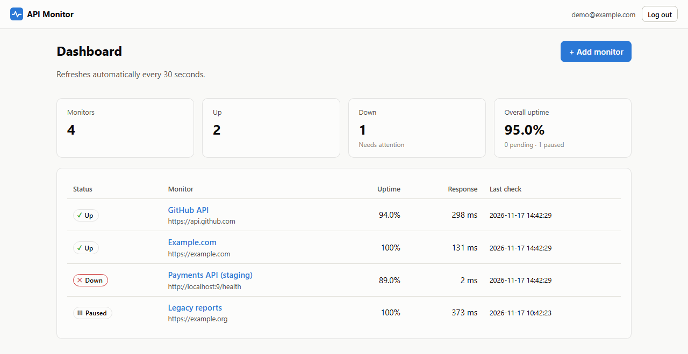
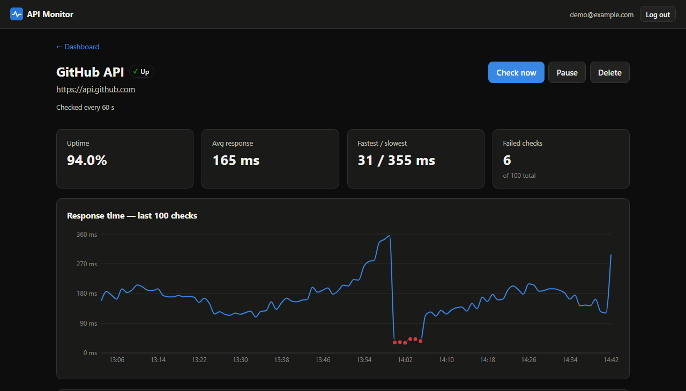
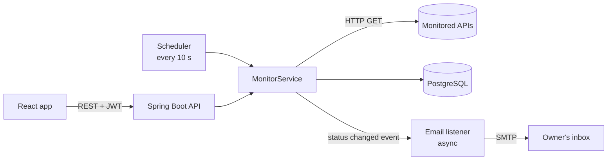

# API Monitor

[](https://github.com/Varant5/ApiMonitor/actions/workflows/ci.yml)


Uptime monitoring for HTTP APIs. Register the URLs you care about — the app checks them on a schedule,
records response times and status codes, shows uptime statistics and **emails you when an API goes down and when it recovers**.




## Features

- **Scheduled checks** with a per-monitor interval (min. 10 s), timeouts and connection-error handling
- **Status history & statistics** — uptime, average / min / max response time, failed checks
- **Email alerts** on outage (`UP → DOWN`) and recovery (`DOWN → UP`) — no repeated alerts while still down
- **User accounts** with JWT authentication; every user sees only their own monitors
- **Dashboard** (React) with response-time chart, light & dark theme
- **Documented REST API** — OpenAPI / Swagger UI with examples
- **Consistent error format** for every error: `{ "status", "message", "errors" }`

## Tech stack

| Area | Technologies |
|---|---|
| Backend | Java 25, Spring Boot 4 (Web MVC, Data JPA, Security, Validation, Mail, Actuator) |
| Auth | Spring Security OAuth2 Resource Server — self-issued JWT (HS256), BCrypt |
| Database | PostgreSQL 17, Flyway migrations |
| Frontend | React 19, TypeScript, Vite, Recharts |
| Testing | JUnit 5, Mockito, MockMvc, Testcontainers (real PostgreSQL) |
| Infrastructure | Docker (multi-stage build), Docker Compose, GitHub Actions, Mailpit (dev SMTP) |

## Quick start

Requires only **Docker**.

```bash
docker compose up -d --build
```

| URL | What |
|---|---|
| http://localhost:8080 | the app — create an account and add a monitor |
| http://localhost:8080/swagger-ui.html | API documentation |
| http://localhost:8025 | Mailpit — inbox with the alert emails |

## Local development

```bash
docker compose up -d db mailpit      # PostgreSQL + fake SMTP server

./mvnw spring-boot:run               # backend on :8080 (or run it from the IDE)

cd frontend && npm install && npm run dev   # frontend on :5173, proxies /api to :8080
```

Tests (Docker must be running — integration tests start PostgreSQL via Testcontainers):

```bash
./mvnw test
```

## How it works



- In production the built frontend is served by Spring Boot, so the whole app is **one container** (no CORS needed).
- The scheduler wakes every 10 s and checks each monitor whose interval has elapsed.
- A status change publishes a Spring application event; the email listener runs `@Async`,
  so a slow mail server never delays the checks.
- Timestamps are stored as `TIMESTAMP WITH TIME ZONE` and returned in UTC; the UI shows them in the browser's time zone.

## API overview

All endpoints except authentication require `Authorization: Bearer <token>`. Full reference with examples: Swagger UI.

| Method | Endpoint | Description |
|---|---|---|
| `POST` | `/api/auth/register` | create an account |
| `POST` | `/api/auth/login` | get a JWT |
| `GET` | `/api/dashboard` | counts by state, overall uptime, latest result of every monitor |
| `GET` `POST` | `/api/monitors` | list / create monitors |
| `GET` `PATCH` `DELETE` | `/api/monitors/{id}` | get / enable-disable / delete a monitor |
| `POST` | `/api/monitors/{id}/check` | run a check now |
| `GET` | `/api/monitors/{id}/checks?limit=20` | check history, newest first |
| `GET` | `/api/monitors/{id}/statistics` | uptime and response-time statistics |

## Configuration

Set through environment variables; the defaults work with `docker compose`.

| Variable | Default | Description |
|---|---|---|
| `DB_URL` / `DB_USERNAME` / `DB_PASSWORD` | local PostgreSQL | database connection |
| `JWT_SECRET` | development key | **set your own in production** — Base64, ≥ 32 bytes (`openssl rand -base64 48`) |
| `JWT_EXPIRATION` | `1h` | access token lifetime |
| `MAIL_HOST` / `MAIL_PORT` | `localhost` / `1025` | SMTP server (Mailpit in development) |
| `MAIL_FROM` | `alerts@api-monitoring.local` | sender of alert emails |
| `NOTIFICATIONS_ENABLED` | `true` | turn email alerts on / off |
| `NOTIFICATIONS_TIME_ZONE` | `Europe/Warsaw` | time zone used in emails |
| `MONITORING_HTTP_TIMEOUT` | `5s` | timeout of a single check |

## Project structure

```
src/main/java/com/example/apimonitoring
├── controller/     REST endpoints
├── service/        business logic (monitors, dashboard, auth)
├── monitoring/     HTTP client and scheduler
├── notification/   status-change event and email listener
├── security/       JWT, Spring Security config, @CurrentUserId
├── entity/ repository/ dto/ exception/ config/
src/main/resources/db/migration/   Flyway SQL migrations
frontend/                          React + TypeScript app
```
